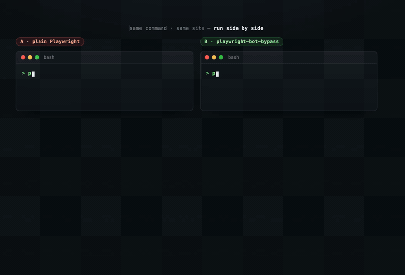
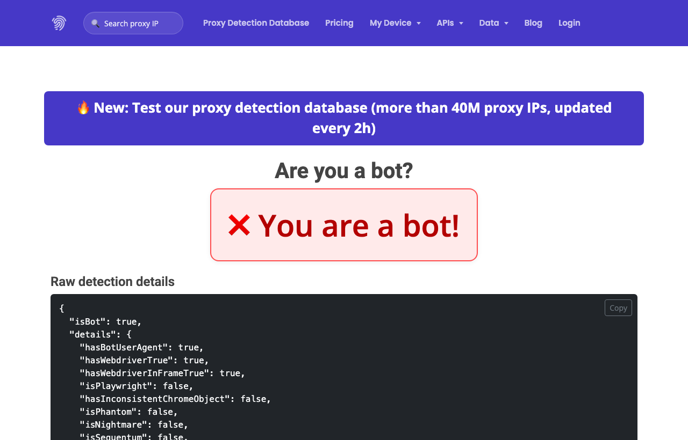
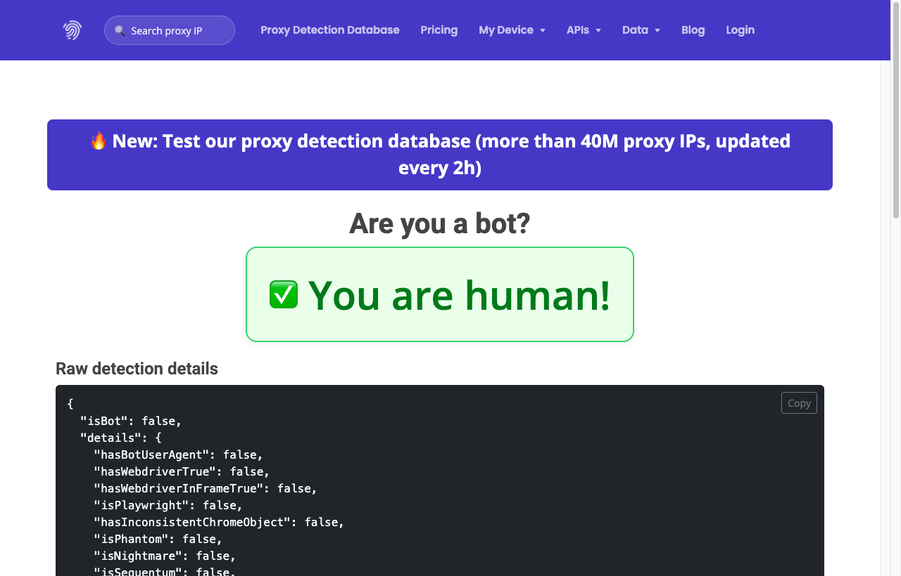
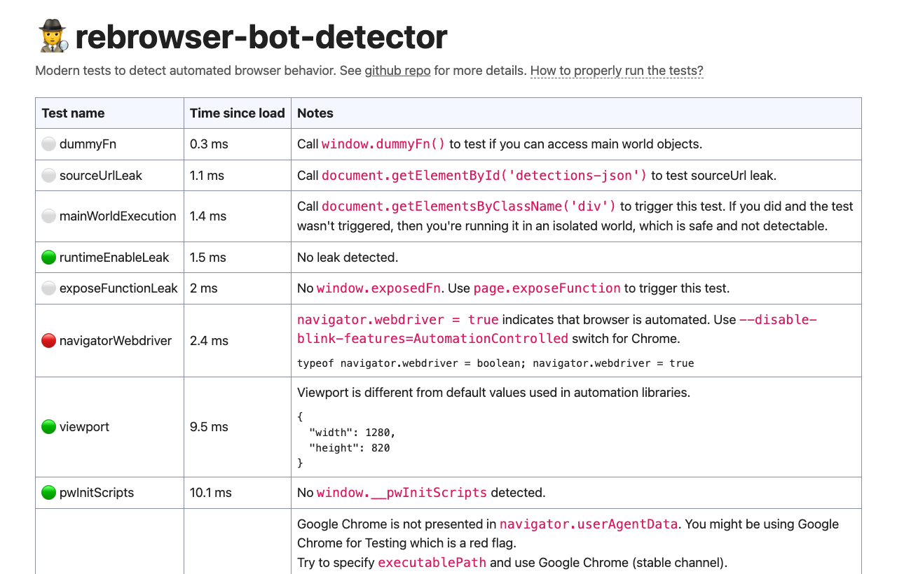
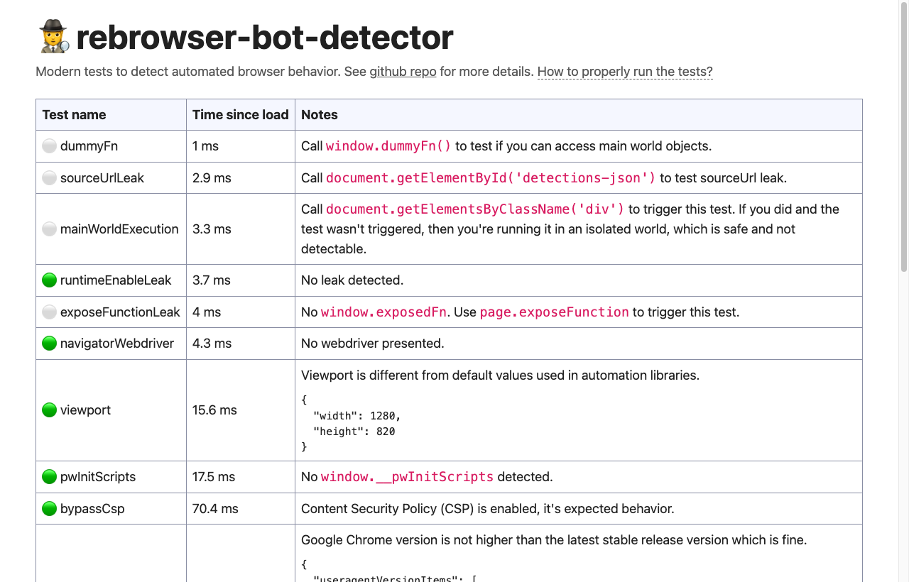
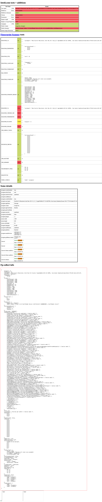
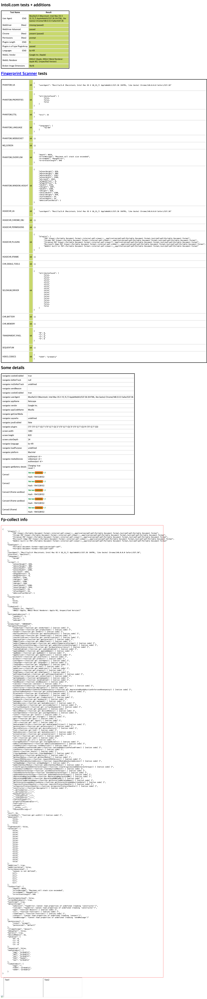

# playwright-bot-bypass

[](https://github.com/greekr4/playwright-bot-bypass)
[](https://skills.sh)
[](https://github.com/greekr4/playwright-bot-bypass/releases)
[](LICENSE)
[](skills/playwright-bot-bypass/SKILL.md)

**Undetected browser automation that passes 8/8 bot detectors** — with a *real* headed Chrome instead of fragile JS fakes. It's glue + tuning over [`rebrowser-playwright`](https://github.com/rebrowser/rebrowser-patches) and [`undetected-chromedriver`](https://github.com/ultrafunkamsterdam/undetected-chromedriver), shipped as a one-import `createStealthBrowser()` and an agent skill.

<p align="center">
  
</p>

> ⚠️ **Authorized use only** — QA, accessibility, and research on sites you own or may test. Respect each site's ToS, `robots.txt`, and the law.

## Install

**Claude Code**

```
/plugin marketplace add greekr4/playwright-bot-bypass
/plugin install playwright-bot-bypass@playwright-bot-bypass
```

**Codex · Cursor · any agent** — one command via [skills.sh](https://skills.sh):

```bash
npx skills add greekr4/playwright-bot-bypass          # all detected agents
npx skills add greekr4/playwright-bot-bypass -a codex # Codex only
```

Then just describe the task, or invoke it explicitly with `$playwright-bot-bypass …`.

## Quick start

```bash
npm install rebrowser-playwright
```

```javascript
import { createStealthBrowser, humanType, simulateMouseMovement } from './scripts/stealth-template.mjs';

const { browser, page } = await createStealthBrowser();
try {
  await page.goto('https://example.com');
  await simulateMouseMovement(page);
  await humanType(page, 'input', 'query');
} finally {
  await browser.close(); // always in finally, or the process hangs
}
```

Prefer Python? `pip install undetected-chromedriver` → `uc.Chrome()`. (Skip `playwright-stealth` — it only patches JS, so WebGL still leaks SwiftShader.)

## What it beats — and what it doesn't

| ✅ Beats | 🚫 Doesn't touch |
|---|---|
| Fingerprint + automation detectors — sannysoft, rebrowser, deviceandbrowserinfo, browserscan, iphey, creepjs (**9/9 reproducible**) | IP reputation & rate limits |
| Real UA, WebGL/GPU, canvas, PluginArray — genuine, **not** JS-spoofed | Behavioral / CAPTCHA gates (Turnstile, DataDome, Kasada) |
| Google search + public Reddit / YouTube / TikTok / X with no bot wall | Login walls 🟡 (Instagram, Facebook, LinkedIn) |

One residual leak, `__playwright_builtins__`, can't be stripped by any current rebrowser version. Full measured matrix → [`SKILL.md`](skills/playwright-bot-bypass/SKILL.md).

## A/B: plain Playwright vs this skill

Measured **2026-06-10** (macOS, Apple Silicon). **A** = default `playwright` (headless bundled Chromium, no stealth). **B** = this skill via `createStealthBrowser()` (headed real Chrome + rebrowser Runtime-fix + Playwright-artifact strip). Same machine, same detectors.

**deviceandbrowserinfo.com — "Are you a bot?"**

| A · plain Playwright | B · this skill |
|:---:|:---:|
|  |  |
| ❌ **"You are a bot!"** (`isBot: true`) | ✅ **"You are human!"** (`isBot: false`) |

**bot-detector.rebrowser.net — CDP / automation tests**

| A · plain Playwright | B · this skill |
|:---:|:---:|
|  |  |
| 🔴 `navigatorWebdriver = true` | 🟢 all green — `webdriver false`, no `__pwInitScripts`, no Runtime leak |

**bot.sannysoft.com — fingerprint suite**

| A · plain Playwright | B · this skill |
|:---:|:---:|
|  |  |
| Red rows: WebDriver / UA = HeadlessChrome / WebGL SwiftShader | All green — real Chrome UA, Apple M2 WebGL, `webdriver false` |

## How it works

Three layers do the work — mostly the real browser, barely any hand-written JS:

1. **rebrowser-playwright + Runtime-fix** — hides the CDP `Runtime.enable` headless leak, reports `webdriver: false`.
2. **`channel:'chrome'` + headed** — real UA, GPU/WebGL, canvas, plugins, and `navigator.languages` via `locale`.
3. **Artifact strip** — deletes `window.__pwInitScripts` on every navigation (the `isPlaywright` signature).

The v2.2 insight: *removing* fake `navigator` patches (spoofed plugins, canvas noise, `webdriver` delete…) beats adding them — every fake created a detectable inconsistency. So v2.2 touches nothing on `navigator`.

## Requirements

Node.js 18+ · real Google Chrome (not just Chromium) · headed mode (`headless: false`, display required).

## Credits

Glue + tuning over other people's work: [rebrowser-patches](https://github.com/rebrowser/rebrowser-patches), [undetected-chromedriver](https://github.com/ultrafunkamsterdam/undetected-chromedriver), real Chrome via `channel:'chrome'`, and the detection research that verifies it — [sannysoft](https://bot.sannysoft.com), [rebrowser-bot-detector](https://github.com/rebrowser/rebrowser-bot-detector), [deviceandbrowserinfo](https://deviceandbrowserinfo.com), [browserscan](https://www.browserscan.net), [CreepJS](https://abrahamjuliot.github.io/creepjs/). Original here is the integration: the `createStealthBrowser()` factory, the verified v2.2 recipe, and the agent-facing [`SKILL.md`](skills/playwright-bot-bypass/SKILL.md).

## License

MIT
